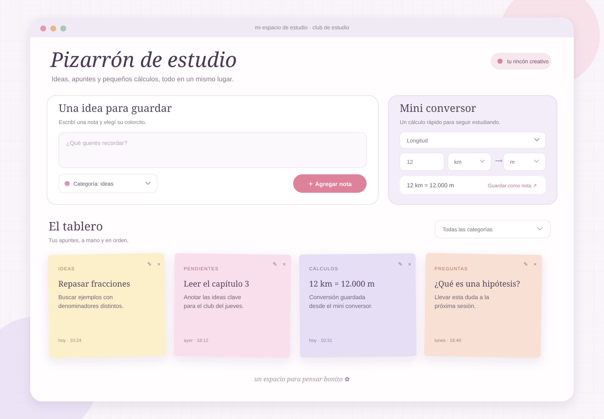
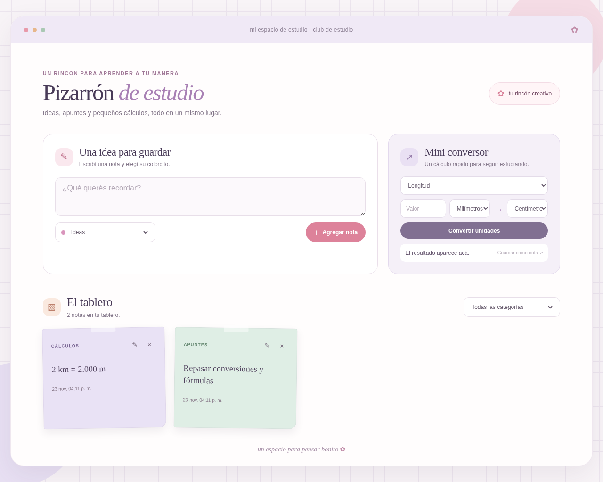
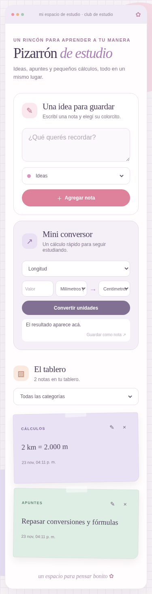

# Pizarrón de estudio

## 🧩 Datos generales

| Campo | Detalle |
| --- | --- |
| Integrante 1 | Avishag Sadrinas |
| Integrante 2 | No corresponde: trabajo individual |
| Modelos de IA utilizados | GPT-6.2 Sol y GPT-6 Luna |
| Tecnologías | HTML, CSS, JavaScript, diagrams.net, Notion y GitHub |
| Tema | Pizarrón de cálculos para un club de estudio |
| Repositorio | [pizarron-de-estudio](https://github.com/avishagsad/pizarron-de-estudio) |

---

## 📄 Sketch

**Archivo editable:** [sketch-pizarron.drawio](evidencias/sketch-pizarron.drawio)



El sketch se hizo antes de pedir el código. La idea era que las notas y el conversor convivieran en una misma pantalla, sin que una parte pareciera agregada después.

---

## 💬 Prompts utilizados

**Prompt 1:**

```txt
Implementá una aplicación web llamada Pizarrón de estudio siguiendo el sketch registrado. Usá solamente HTML, CSS y JavaScript, sin frameworks. La pantalla debe combinar notas adhesivas y un conversor de unidades. Usá los IDs texto-nota, categoria-nota, agregar-nota, tablero-notas, tipo-conversion, valor-origen, unidad-origen, unidad-destino, convertir-unidad y resultado-conversion. Permití crear, editar, eliminar y filtrar notas por categoría, conservándolas en localStorage. El conversor debe trabajar con longitud, peso y temperatura, validar valores y unidades, y permitir guardar el resultado como una nota. Respetá la estética femenina y artsy del sketch, con tonos lavanda, rosa y coral. La interfaz debe ser semántica, accesible y adaptable a celular.
```

**Prompt 2 — ajuste:**

```txt
Ajustá la distribución para que el formulario de notas y el mini conversor se entiendan como partes del mismo pizarrón. Conservá los tonos lavanda, rosa y coral, agregá detalles de papel y asegurate de que en celular no haya desbordamiento horizontal.
```

**Prompt 3 — corrección:**

```txt
El botón para guardar una conversión debe usar el identificador guardar-resultado, porque es el nombre definido para conectar el sketch con JavaScript. Corregí el HTML y el selector del script sin cambiar su comportamiento.
```

---

## 🔄 Diferencias entre versiones

| Versión | Cambios | Motivo |
| --- | --- | --- |
| v1 | Sketch combinado de notas y conversor. | Definir la referencia visual antes del código. |
| v2 | Alta, edición, borrado, filtros y persistencia de notas. | Completar el funcionamiento del tablero. |
| v3 | Conversión de longitud, peso y temperatura. | Incorporar los cálculos y sus validaciones. |
| v4 | Resultado guardable como nota y ajuste del ID de conexión. | Integrar las dos partes y respetar los nombres del sketch. |

## Planeamiento

El pizarrón usa `localStorage`, por eso las notas quedan guardadas en el dispositivo. Los resultados del conversor se agregan en la categoría Cálculos. No hay servidor ni dependencias externas.

## Pruebas realizadas

- Crear, editar, eliminar y filtrar notas.
- Recargar la página y conservar el tablero.
- Convertir 2 km a 2000 m y 0 °C a 32 °F.
- Rechazar valores vacíos y temperaturas inferiores al cero absoluto.
- Guardar una conversión como nota.
- Navegar con teclado y revisar ausencia de errores de página.
- Verificar que no haya desbordamiento en escritorio y celular.

### Capturas





## Estado del proyecto

- [x] Sketch previo al prompt
- [x] Notas adhesivas funcionando
- [x] Conversor conectado con el tablero
- [x] Validaciones realizadas
- [x] Capturas guardadas
- [x] README completo
- [x] Repositorio público
- [x] [PDF de consolidación preparado](evidencias/Preentrega4_Sadrinas_Avishag.pdf)

La presentación en Coderhouse queda a cargo de la estudiante.
